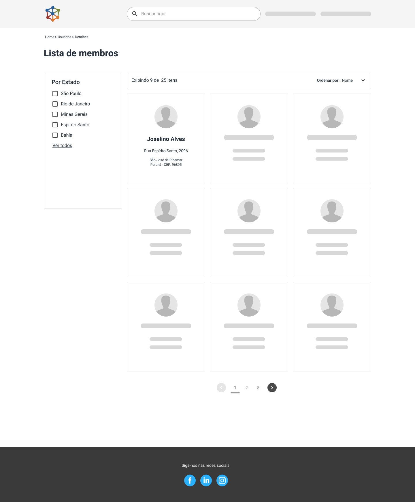
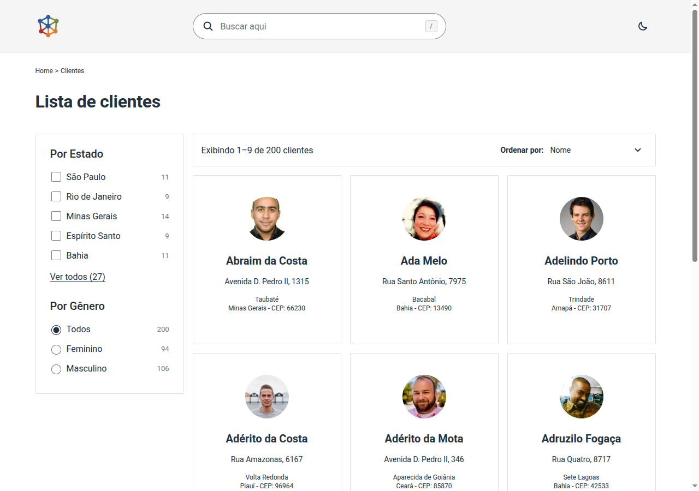
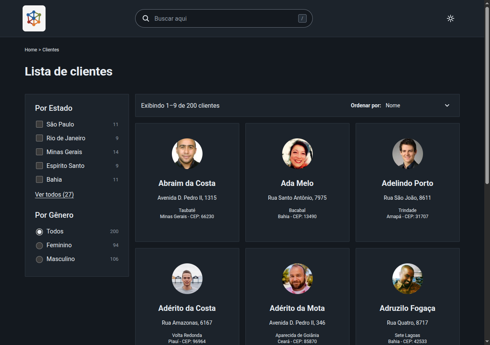
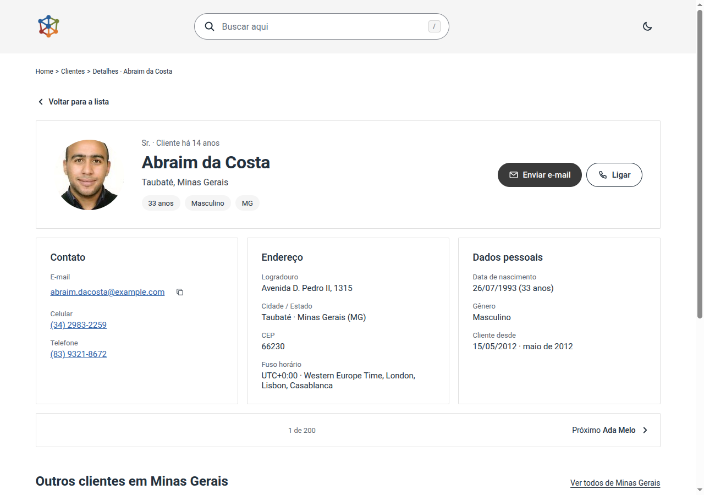
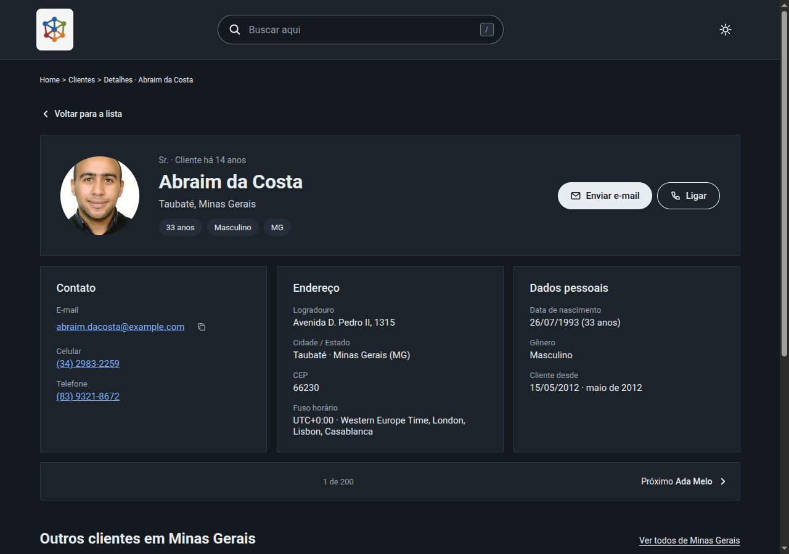

# customer-directory

Diretório de clientes feito para o [desafio de frontend da Juntos Somos Mais](https://github.com/juntossomosmais/frontend-challenge): lista com busca, filtros, ordenação e paginação, e uma página de detalhe por cliente.

**Produção:** https://customer-directory-nu.vercel.app

Os previews de PR exigem login na Vercel; para navegar no app, use a produção.

## Stack

Nuxt 4 (Vue 3 + TypeScript, SSR), Nitro como BFF, CSS Modules + SCSS, Vitest e Playwright. Deploy na Vercel.

## Setup

Requer Node `^24.15.0` e npm.

```sh
nvm install
npm ci
npm run dev
```

## Scripts

| Comando             | O que faz                                                                                                   |
| ------------------- | ----------------------------------------------------------------------------------------------------------- |
| `npm run dev`       | servidor de desenvolvimento                                                                                 |
| `npm run build`     | build de produção                                                                                           |
| `npm run preview`   | serve o build de produção                                                                                   |
| `npm run analyze`   | relatório do tamanho do bundle, gravado em `node_modules/.cache/nuxt/.nuxt/analyze/` (apagado por `npm ci`) |
| `npm run lint`      | ESLint + Stylelint + Prettier (`--check`)                                                                   |
| `npm run format`    | Prettier (`--write`)                                                                                        |
| `npm run typecheck` | `nuxt typecheck`                                                                                            |
| `npm test`          | Vitest (unidade, componente e API)                                                                          |
| `npm run test:e2e`  | Playwright (gera o build antes de rodar)                                                                    |

## Arquitetura

Nuxt 4 com SSR e Nitro como BFF ([ADR-0002](docs/adr/0002-nuxt-4-com-ssr.md), [ADR-0004](docs/adr/0004-nitro-como-bff.md)):

- `server/api/` tem os handlers finos; `server/utils/` concentra as funções puras (`queryCustomers`, `normalizeCustomer`, `parseRawCustomers`) e o fetch da fonte S3 com cache de 1h + stale-while-revalidate ([ADR-0005](docs/adr/0005-cache-da-fonte-s3.md)). Busca, filtro, ordenação e paginação rodam no BFF, sobre os 200 registros da fonte.
- `shared/` guarda os tipos e utilitários dos dois lados; o `parseListQuery` é o único ponto que valida a query da URL.
- `app/` tem páginas, layouts e componentes (`Nome/Nome.vue` + `Nome.module.scss`), construídos do zero sobre HTML nativo ([ADR-0003](docs/adr/0003-css-modules-scss-e-componentes.md)).
- **A URL é a fonte da verdade da lista**: busca, filtros, ordenação e paginação são chaves da query, e qualquer estado se reconstrói do endereço ([ADR-0007](docs/adr/0007-estrategia-de-estado.md)). Sem store global — `useState` só para tema e toast.
- O cliente é acessível pelo slug do e-mail ([ADR-0006](docs/adr/0006-slug-a-partir-do-email.md)), e o tema claro/escuro vai por cookie, servido na primeira pintura ([ADR-0011](docs/adr/0011-dark-mode-com-cookie.md)).

## Melhorias sobre o layout original

O desafio traz um layout de referência e diz que é só um protótipo. O app partiu dele para o protótipo v2 ([`docs/design/`](docs/design/)), fonte da verdade de UI ([ADR-0013](docs/adr/0013-prototipo-como-fonte-da-verdade.md)), e melhorou o que o original não cobria ou cobria mal; as divergências de propósito estão registradas na ADR-0013.

| Antes — layout original do desafio                             | Depois — app em produção                                         |
| -------------------------------------------------------------- | ---------------------------------------------------------------- |
|  |  |

_Antes: [`layout-jsm.png`](https://github.com/juntossomosmais/frontend-challenge/blob/master/layout-jsm.png) do repositório do desafio._





- **Correções de contraste nos tokens** (o protótipo v2 tinha três defeitos): `--overlay` apontando para si mesma, que apagava o fundo escurecido do sheet no tema claro; a borda do input a 2,99:1 e o "/" do atalho a 4,34:1, os dois corrigidos para o mínimo AA.
- **"Clientes" em vez de "membros"**, com singular correto na contagem ([ADR-0020](docs/adr/0020-clientes-em-vez-de-membros.md)).
- **Dark mode servido na primeira pintura**, por cookie, sem flash ([ADR-0011](docs/adr/0011-dark-mode-com-cookie.md)).
- **Filtro por gênero e contagem em cada filtro** (o original só tem estado, sem contagem).
- **Detalhe por slug do e-mail** em vez da posição na lista: o endereço do cliente é estável e compartilhável ([ADR-0006](docs/adr/0006-slug-a-partir-do-email.md)).
- **Estado completo na URL** (`?search=&states=&gender=&sort=&page=&perPage=`): qualquer tela se reconstrói do link ([ADR-0021](docs/adr/0021-url-publica-em-ingles.md)).
- **Navegação e foco gerenciados**: "Limpar busca e filtros" devolve o foco aos resultados, a troca de página rola até a toolbar sem tirar o controle focado da tela ([ADR-0022](docs/adr/0022-rolagem-ate-os-resultados.md)); percorrer o select pelo teclado deixa uma entrada só no histórico.
- **Falhas com recuperação**: 502 da fonte com "Tentar novamente" que mantém os filtros e devolve o foco, lista vazia com dica contextual, 404 do cliente anunciado e focado ([ADR-0024](docs/adr/0024-annuncio-e-foco-na-pagina-de-erro.md)).
- **Paginação com um clique a menos**: a reticência que escondia uma página única no protótipo v2 virou o próprio número.

## Performance e bundle

Lighthouse na produção, mobile, com as piores corridas de cada página:

| Página  | Performance | Acessibilidade | Best Practices | SEO |
| ------- | ----------- | -------------- | -------------- | --- |
| Lista   | 99          | 100            | 100            | 100 |
| Detalhe | 95          | 100            | 100            | 100 |

Repetições deram 99–100 na lista e 95–98 no detalhe. Medição com o Lighthouse CLI 13.6.0, throttling mobile simulado, na produção em 2026-11-11.

O LCP fica em 1,0–1,3 s na lista e 2,2–2,3 s no detalhe; o elemento LCP do detalhe é o avatar externo da randomuser.me.

Bundle client, na saída do `npm run analyze`: 104 KB de JS gzip em 9 chunks (os maiores: `ssr.js` 55 KB, `entry.js` 26 KB e `customers.js` 8 KB) e 9,4 KB de CSS gzip em 5 arquivos.

O analyze sobrescreve o `.output` com o build de análise; rode `npm run build` depois para repor o build normal.

## O que ficou de fora

- **Mapa com as coordenadas**: as coordenadas da fonte caem fora do Brasil, então o mapa não existe ([ADR-0008](docs/adr/0008-sem-mapa.md)).
- **Extras da seção "Seja criativo"**, registrados como candidatos e não implementados por prazo: `<mark>` na busca, View Transitions, resultados esmaecidos durante a carga, atalhos ←/→ no detalhe, exportação vCard e hora local; aniversariantes, faixa etária e exportação CSV; favoritos em cookie, print stylesheet e PWA.
- **Experimentos de performance descartados** por não provarem ganho na produção: proxy mesmo-origem para as fotos e remover o `fetchpriority` do avatar.
- **Itens cortados da auditoria final**, para reabrir após a entrega: refactor do leitor único do estado em voo ([#95](https://github.com/adamsalves/customer-directory/issues/95)), anúncio do total no sheet ([#97](https://github.com/adamsalves/customer-directory/issues/97)), animação de saída do sheet ([#99](https://github.com/adamsalves/customer-directory/issues/99)), provar/matar o `watch` do painel de filtros ([#105](https://github.com/adamsalves/customer-directory/issues/105)), o `TypeError: terminated` do ofetch com a fonte cortada no meio ([#110](https://github.com/adamsalves/customer-directory/issues/110), nunca reproduzido) e o 404 geral fora do cliente ([#122](https://github.com/adamsalves/customer-directory/issues/122); o skip-link do erro seguiu na #41).
- **A volta ao repouso do carrossel**: o Chromium não volta ao repouso do snap em rolagem programada — o snap fica garantido no CSS computed, e a prova comportamental ficou sem asserção, por decisão do dono na #137.

## Critérios de avaliação

O desafio avalia 7 competências; onde cada uma aparece:

| Competência                 | Onde aparece                                                                                                                                                                                                                                                                                                                                                                  |
| --------------------------- | ----------------------------------------------------------------------------------------------------------------------------------------------------------------------------------------------------------------------------------------------------------------------------------------------------------------------------------------------------------------------------- |
| Resolução de problemas      | requisitos completos com os casos extremos cobertos: fonte fora do ar (502 com "Tentar novamente"), lista vazia com dica contextual, 404 do cliente, loading com skeletons ([ADR-0009](docs/adr/0009-estrategia-de-testes.md))                                                                                                                                                |
| Arquitetura de código       | [Arquitetura](#arquitetura): BFF com funções puras, `shared/` com o único validador da URL, componentes por pasta com CSS Modules ([ADR-0002](docs/adr/0002-nuxt-4-com-ssr.md), [0004](docs/adr/0004-nitro-como-bff.md), [0007](docs/adr/0007-estrategia-de-estado.md))                                                                                                       |
| Qualidade de código         | tipagem honesta sem `any` e casts ([ADR-0016](docs/adr/0016-tipagem-honesta.md)), código em inglês e interface em pt-BR ([ADR-0017](docs/adr/0017-idioma-codigo-e-interface.md)), lint tipado + Stylelint + Prettier no pre-commit e no CI ([ADR-0010](docs/adr/0010-qualidade-hooks-e-ci.md))                                                                                |
| Testes                      | unidade, componente e API em Vitest; E2E em Playwright nos projetos desktop e mobile, sem rede ([ADR-0009](docs/adr/0009-estrategia-de-testes.md)); cada checagem nova provada por mutação; specs ao lado do código                                                                                                                                                           |
| UI/UX                       | protótipo como fonte da verdade ([ADR-0013](docs/adr/0013-prototipo-como-fonte-da-verdade.md)), responsividade só com CSS ([ADR-0014](docs/adr/0014-responsividade-so-com-css.md)), Alto Contraste e `prefers-reduced-motion`, a11y auditada ([ADR-0024](docs/adr/0024-annuncio-e-foco-na-pagina-de-erro.md)), [melhorias sobre o layout](#melhorias-sobre-o-layout-original) |
| Performance & boas práticas | [Performance e bundle](#performance-e-bundle): Lighthouse 99–100 na lista e 95–98 no detalhe, 104 KB de JS gzip; SEO com `useSeoMeta`; cache SWR no BFF ([ADR-0005](docs/adr/0005-cache-da-fonte-s3.md))                                                                                                                                                                      |
| Colaboração com IA          | [`ai-journey/`](ai-journey/README.md): método, prompts e learnings, com registro por issue; regras escritas para os agentes no [AGENTS.md](AGENTS.md) ([ADR-0001](docs/adr/0001-registrar-decisoes-em-adrs.md))                                                                                                                                                               |

## Documentação

- **Decisões de arquitetura:** [`docs/adr/`](docs/adr/README.md)
- **Design (fonte da verdade de UI):** [`docs/design/`](docs/design/), protótipo v2 feito no Claude Design. `diretorio-de-membros.html` é o app completo; `diretorio-de-membros-responsivo.html` traz as molduras de 375 e 768px nos dois temas. Para navegar, clone o repositório e abra o HTML no navegador (o GitHub mostra só o código-fonte). Os desvios estão na [ADR-0013](docs/adr/0013-prototipo-como-fonte-da-verdade.md).
- **Uso de IA:** [`ai-journey/`](ai-journey/README.md)
- **Instruções para agentes de código:** [`AGENTS.md`](AGENTS.md)
